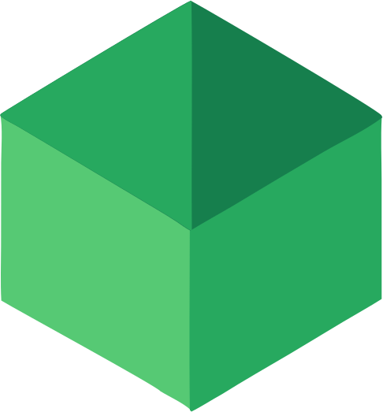
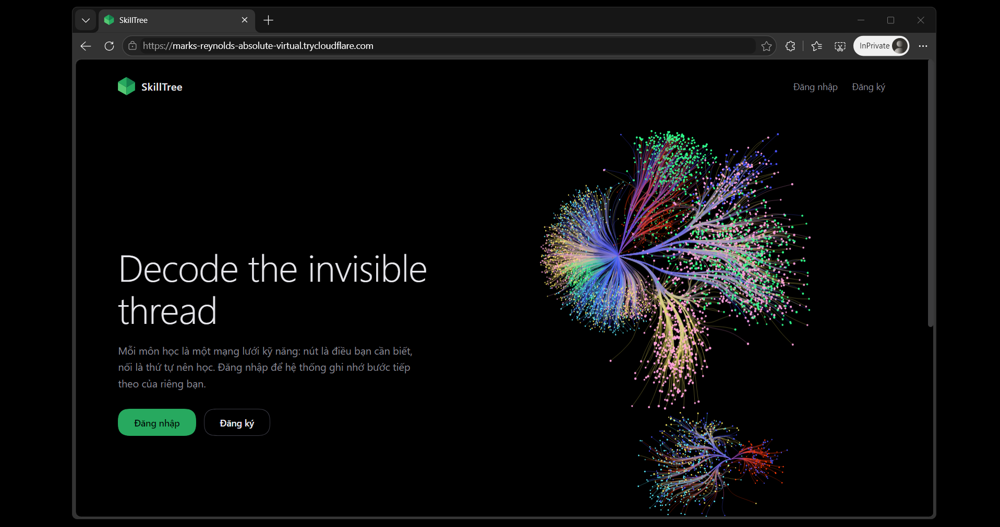

<div align="center">



# SkillTree

**Decode the invisible thread.**

[](https://github.com/Stellarhold170NT/skill-tree/stargazers)
[](https://github.com/Stellarhold170NT/skill-tree/graphs/contributors)
[](LICENSE)
[](DESIGN.md)

</div>

> [!TIP]
> Every node is a skill. Every thread is what you need to learn first.

<div align="center">

<picture>
  <source media="(prefers-color-scheme: dark)" srcset="resources/screenshot.png">
  
</picture>

</div>

SkillTree turns a syllabus into a living skill graph. Students always know the next step. Teachers see where the whole class is stuck.

## Why SkillTree

- **Syllabus in, roadmap out.** Upload course material — it becomes skills and prerequisite threads.
- **Learn in the right order.** The graph points to what is ready next, not what is merely next in line.
- **See the whole class at once.** A heatmap shows which skill is jamming and who needs help.

## Quick start

```bash
git clone https://github.com/Stellarhold170NT/skill-tree
cd skill-tree
cp deploy/.env.example deploy/.env
docker compose -f deploy/docker-compose.yml up -d --build
```

Open the web UI, register — the first account becomes the admin.

## Architecture

Small services behind one gateway: auth, classes, documents, quiz, learner model, RAG and the concept-graph engine — one container each, wired by [deploy/docker-compose.yml](deploy/docker-compose.yml). Module map in [docs/MODULES.md](docs/MODULES.md).

## Docs

- [Design](DESIGN.md) — architecture and decisions
- [Deployment](docs/deployment.md) — how the stack runs
- [Evaluation harness](docs/eval-harness.md) — how correctness is measured
- [Handover](docs/run-final-handover.md) — operations runbook
